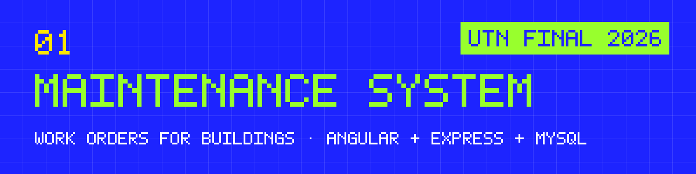
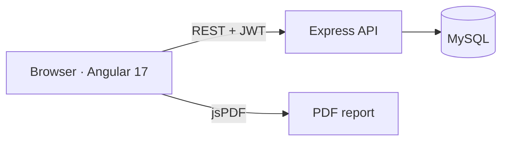

<p align="center"></p>

**Work orders for building maintenance, from request to report.** An admin creates a work order for an asset in a building, assigns tasks to an operator, the operator checks them off, and every order ends up in a history that can be exported to PDF.

`Angular 17` · `Angular Material` · `Node.js` · `Express` · `MySQL` · `JWT` · `Swagger`

> **En español:** sistema web para gestionar el mantenimiento de edificios: órdenes de trabajo, tareas asignadas a operarios, historial y reportes en PDF. Es mi proyecto final de la Tecnicatura Universitaria en Programación (UTN), 2026.

## The problem

Building maintenance usually runs on paper, WhatsApp and memory: nobody knows which air conditioner was checked last month, who did it, or which tasks are still open.

## What I built

| Part | What it does |
|---|---|
| **Login and roles** | JWT authentication with two roles: `administrador` manages everything, `operario` sees and completes their tasks. Passwords hashed with bcrypt. |
| **Catalogs** | Create, edit and delete buildings, floors, sectors, locations, assets and tasks. |
| **Work orders** | An order links an asset in a place to a list of tasks and an assigned operator. Each task is checked off as it gets done. |
| **History** | Every work order with its state, filterable, and exportable to PDF. |
| **API docs** | The REST API is documented with Swagger; the frontend with Compodoc. |

## How it works



- `frontEnd/`: Angular 17 with Angular Material. Login, catalog management, work orders, history, and a route guard by role.
- `backEnd/`: Express API with routes for login, users, catalogs and work orders, plus middleware for auth and errors.
- `bd/mantenimiento.sql`: schema and seed data (assets, tasks and an admin user).

## How I built it

Final project for the UTN programming degree, which I presented and defended in front of the evaluation panel. I built it with AI coding tools; the data model, the role rules and the defense were mine.

## Run it

You need Node.js 18+ and MySQL.

```bash
# 1. Database
mysql -u root -p < bd/mantenimiento.sql

# 2. API (http://localhost:3000, docs at /api-docs)
cd backEnd
npm install
npm run dev

# 3. Frontend (http://localhost:4200)
cd ../frontEnd
npm install
npm start
```

The API reads `DB_HOST`, `DB_USER`, `DB_PASSWORD`, `DB_DATABASE` and `DB_PORT` from a `.env` file in `backEnd/` (defaults: `localhost`, `root`, no password, `mantenimiento`, `3306`).

## Status

Finished and approved in March 2026. Not deployed.

## What I'd do next

- Tests for the API (the role rules first).
- Notifications when an operator gets a new task.
- Deploy a demo with sample data.

---

<sub>01 · Part of the work of <a href="https://github.com/ayrtongenovesi">Ayrton Genovesi</a>, Rosario, Argentina. I build with AI and make sure it works.</sub>
